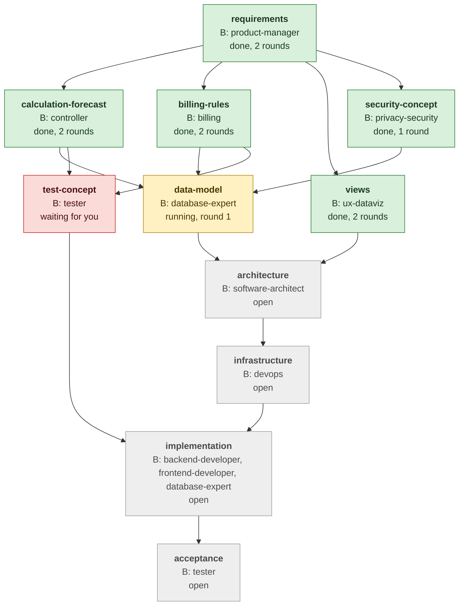
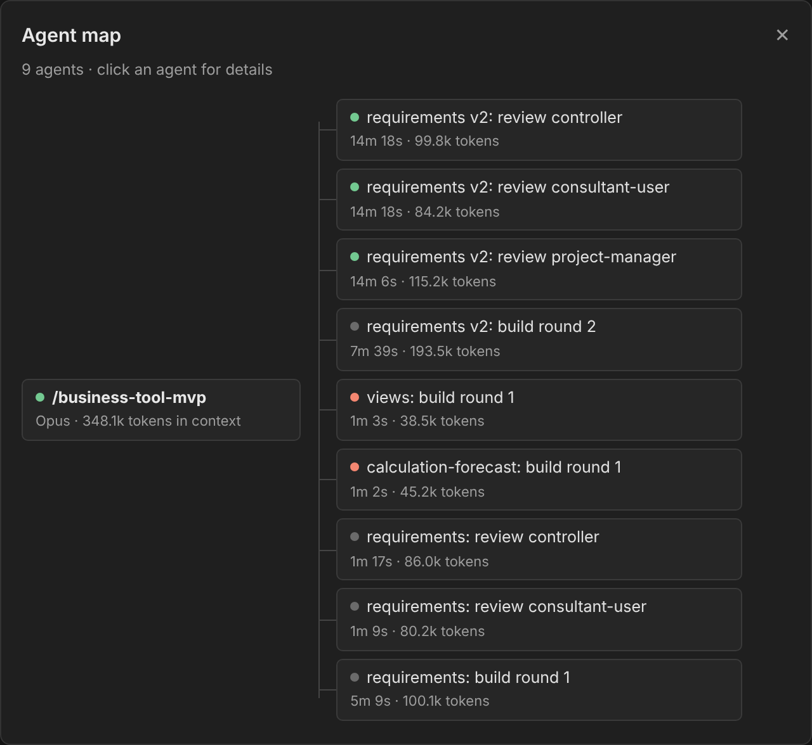
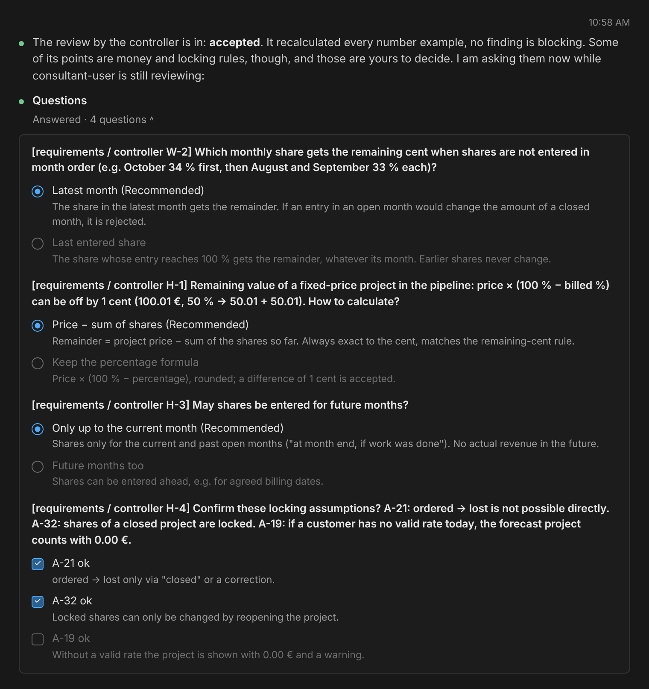
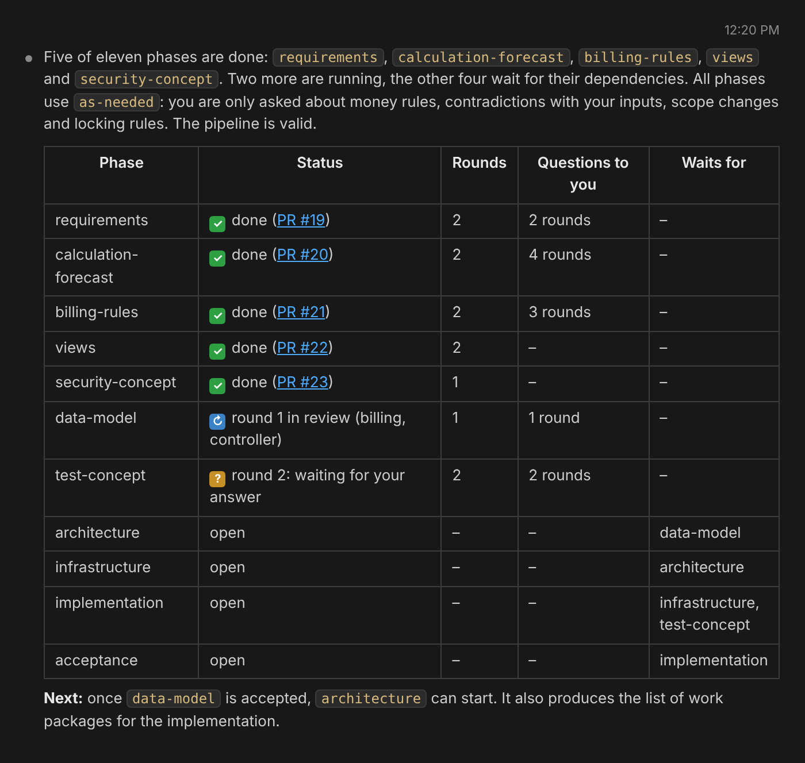
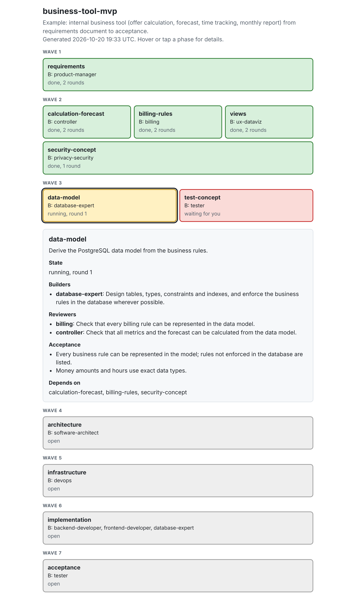
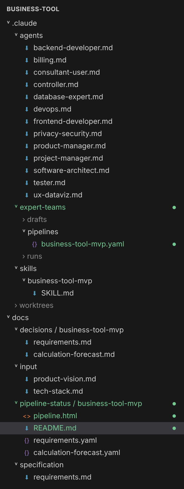
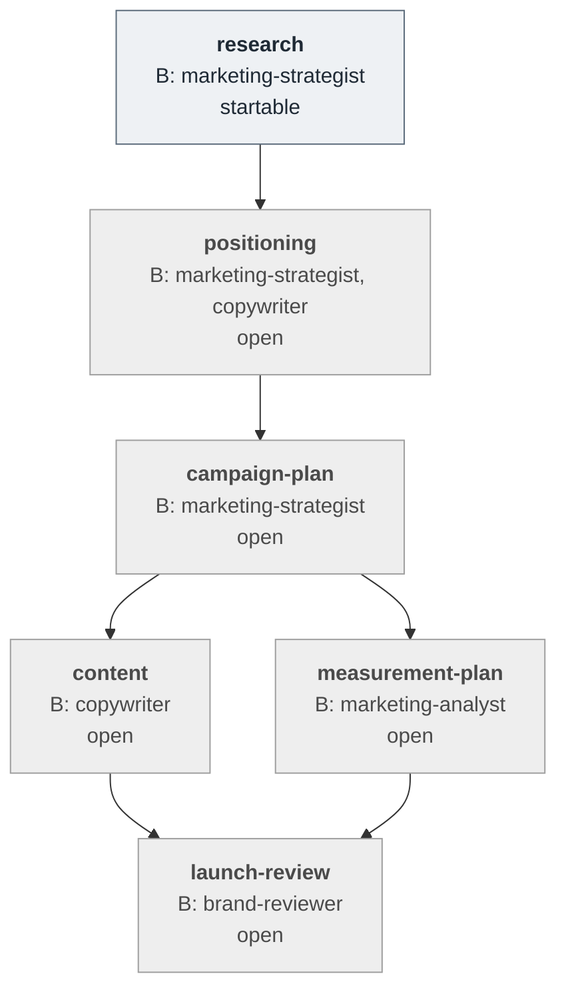

# expert-teams

**Describe your idea, and a team of expert agents builds it: in every phase builders create, reviewers challenge, until all of them accept.**

`expert-teams` is a Claude Code plugin for any work that benefits from a second pair of eyes: software, marketing, research, documentation, text-to-speech audio. It talks you through your project until a pipeline of phases and roles is clear, writes that pipeline as a commented YAML file, and then runs it with subagents: in parallel where phases do not depend on each other, in git worktrees, with a pull request per phase. Questions about money, scope or contradictions come to you; everything else the team settles itself and writes down.

This is the example pipeline from [`examples/business-tool-mvp.yaml`](examples/business-tool-mvp.yaml) in the middle of a run, as `/expert-teams:status` draws it (B = builder):



## Installation

```
/plugin marketplace add florianpirchner/claude-plugins
/plugin install expert-teams@florianpirchner
```

To offer the plugin to everyone who opens a project, add it to the project's `.claude/settings.json`:

```json
{
  "extraKnownMarketplaces": {
    "florianpirchner": {
      "source": { "source": "github", "repo": "florianpirchner/claude-plugins" }
    }
  },
  "enabledPlugins": {
    "expert-teams@florianpirchner": true
  }
}
```

Requirements in the target project: git, Node.js 18 or later (for the bundled check scripts, nothing to install) and `gh` if phases are delivered as pull requests. Update with `/plugin marketplace update florianpirchner`.

## How it works

### 1. Create the pipeline together

`/expert-teams:create` is a conversation in five stages. You decide when a stage is finished, and a restart continues where you left off.

| Stage | What happens |
|---|---|
| **Brainstorming** | You tell your idea freely. Claude follows up with open questions, one at a time, and keeps track of goals, users, inputs and limits. Then it proposes the [domain packs](#domain-packs) that fit, each with a reason. |
| **Grill me** | You confirm the packs, and Claude asks their questions: the technology for software (your fixed choice, or advice from [`domains/software/stack-guide.md`](domains/software/stack-guide.md)), the brief for marketing, research or docs. Then it looks for gaps, contradictions and risks and asks about them one by one, and ends with the base questions as one list to confirm: language, delivery, branches, checks, worktrees, review rounds, models, human in the loop. |
| **Team** | Which expert roles the project needs, each as a self-contained agent file. |
| **Flow** | Phases, their order, and per phase the one builder, its reviewers and its consultants. |
| **Generate** | Writes the agent files, `.claude/expert-teams/pipelines/<name>.yaml` and a shortcut `/<name>`. |

### 2. Run it

`/expert-teams:run <name>` (or the shortcut `/<name>`) starts every phase whose dependencies are done, several at a time. Each phase runs in rounds: the builder writes, the reviewers check in parallel, and the builder reworks the blocking findings, until all reviewers accept or `maxRounds` is reached. Claude Code's agent map shows the team at work:



### 3. Answer what only you can decide

When a role hits a question it cannot answer from the inputs, it pauses and the orchestrator gets the answer: from another role, or from you if it is one of your cases (`askHumanWhen`, for example money rules). You get the question with options and a recommendation; the role then continues with its full context.



### 4. Follow the progress

`/expert-teams:status` (or `/<name> status`) shows where every phase stands, what it waits for and how often you were asked:



With every delivered phase the run also updates `docs/pipeline-status/<name>/README.md` (the Mermaid chart above, shown by GitHub) and `pipeline.html`, one file without dependencies: tap a phase for its task, builder, reviewers, consultants and acceptance criteria.



## Commands

| Command | What it does |
|---|---|
| `/expert-teams:create [<name>]` | Creates a pipeline in the five stages above. |
| `/expert-teams:modify <name>` | Changes an existing pipeline in the same stages: roles, phases, pairs, order or rules. Shows the differences before it writes. |
| `/expert-teams:run <name> [status \| <phase-id>] [--autonomous \| --as-needed \| --always]` | Runs all open phases, shows the state, or runs exactly one phase. The flag overrides the human-in-the-loop level for this run. |
| `/expert-teams:status [<name>]` | Shows the state of all pipelines or one, open drafts, and writes the views. |
| `/expert-teams:migrate` | Brings pipelines of older plugin versions (JSON in `.claude/pipelines/`, JSON status files, `docs/entscheidungen/<name>/`, pipelines without `domains`, `participants` lists of schemaVersion 1) into the current layout. Shows the plan first and asks before it writes. |
| `/<name> …` | Shortcut for `/expert-teams:run <name> …`, generated by create. |

## What you get



| Path | Content |
|---|---|
| `.claude/agents/<role>.md` | One self-contained file per role. |
| `.claude/expert-teams/pipelines/<name>.yaml` | The pipeline: rules, phases, roles, tasks. Schema: [`schemas/pipeline.schema.json`](schemas/pipeline.schema.json). |
| `.claude/expert-teams/drafts/` | State of create and modify, saved after every decision. |
| `.claude/expert-teams/runs/<name>.yaml` | Live state of a run. Belongs in `.gitignore`, like `.claude/worktrees/`. |
| `.claude/skills/<name>/SKILL.md` | The shortcut `/<name>`. |
| `docs/input/` | Your inputs, e.g. the product vision and the files grill me writes (`tech-stack.md`, `marketing-brief.md`). Agents read them and never change them. |
| `docs/decisions/<name>/<phase-id>.md` | Questions with their answers, assumptions, stalemate decisions. |
| `docs/pipeline-status/<name>/` | One status file per finished phase, plus `README.md` and `pipeline.html`. |

Several pipelines live side by side, e.g. `initial-run`, `optimize-performance`, `migrate-ui-react-to-vue`.

<br clear="right">

All data files are YAML, so the pipeline explains its own choices in comments. An excerpt from the example:

```yaml
name: business-tool-mvp
domains: [software]
rules:
  # Code, documents and user interface in English, even though the product vision is German.
  language: { code: en, docs: en, ui: en }
  # After three review rounds, remaining findings are decided instead of reworked again.
  maxRounds: 3
  delivery: pr-merge
  baseBranch: main
  # Lint, type check and tests before every commit in phases with code: true.
  preCommit: npm run check
  # Agents settle most questions themselves; only the cases below go to the user.
  humanInTheLoop: as-needed
  askHumanWhen:
    - Prices, hourly rates, margins or other money amounts
phases:
  - id: requirements
    goal: Turn the MVP scope from the product vision into testable requirements.
    dependsOn: []
    builder:
      agent: product-manager
      task: Derive user stories and requirements with IDs and acceptance criteria from the product vision.
      outputs: [docs/specification/requirements.md]
    reviewers:
      - agent: controller
        task: Check whether calculation, forecast and reports are fully specified.
    consultants:
      - agent: billing
        about: Billable time and month-end closing
    acceptance:
      - Every requirement has verifiable acceptance criteria.
```

## Domain packs

The core of the plugin knows roles, phases, rounds, questions, branches and status, but nothing about any field of work. That knowledge lives in packs under [`domains/`](domains), listed in [`domains/index.yaml`](domains/index.yaml):

| Pack | For | Example roles |
|---|---|---|
| [`software`](domains/software/SKILL.md) | Apps, APIs, tools: requirements, architecture, code, tests, operation. Asks for the technology and where it runs. | product-manager, software-architect, backend-developer, frontend-developer, tester and 8 more |
| [`marketing`](domains/marketing/SKILL.md) | Audience, positioning, campaigns, content, measurement. Writes drafts and plans, never publishes. | marketing-strategist, copywriter, marketing-analyst, brand-reviewer |
| [`research`](domains/research/SKILL.md) | Market, competitor or option analyses for a decision; every claim has a source. | researcher, fact-checker |
| [`docs`](domains/docs/SKILL.md) | Manuals, how-to guides, specifications, READMEs; the reviewer follows every step as the target reader. | technical-writer, reader-reviewer |
| [`audio`](domains/audio/SKILL.md) | Text-to-speech with the [ElevenLabs](https://elevenlabs.io) API: narration for the ear, voice casting, generation, loudness and checks. The API is paid: text is accepted before generation, takes are cached, every paid call is estimated against your budget. The key comes from `ELEVENLABS_API_KEY` and is never committed. | narration-writer, voice-director, audio-engineer, audio-qa |

Each pack is one `SKILL.md` with the same five sections: what grill me asks (`Grill me`), defaults for the base questions, team, typical flow, and lines for every build and review task. `/expert-teams:create` proposes the packs after the brainstorming, you confirm them, and the pipeline records them in `domains`; `/expert-teams:modify` and `/expert-teams:run` then load exactly those packs. A project can combine packs, e.g. `[marketing, software]` for a launch with its own landing page. A pipeline without `domains` uses `[software]`, and `validate.mjs` rejects a pack that does not exist.

A new pack is a folder `domains/<name>/` with a `SKILL.md` in these five sections and example roles in `agents/`, plus an entry in `index.yaml` with a description and the cues that make create propose it.

## Concepts

**Builder, reviewers, consultants.** Every phase has exactly one `builder` (an object), at least one entry in `reviewers` and optionally `consultants` (both lists). The builder creates the results, the reviewers check them, the consultants only answer questions. If a result needs two builders, it is two phases. The orchestrator spawns each role as a fresh subagent that only gets its task. Reviewers mark findings as blocking or not; only blocking ones start another round. After `maxRounds` the remaining findings are decided and recorded instead of reworked forever.

**Consult questions.** A role may end its reply with a `CONSULT` block. The orchestrator gets the answer from the phase's `consultants` (or another fitting role) or from you, and resumes the role with `SendMessage`, so it keeps its full context. The orchestrator mediates because in Claude Code a subagent cannot spawn agents itself. `rules.consult` switches this on or off and limits it per round (default 3).

**Human in the loop.** `rules.humanInTheLoop` decides who answers:

| Level | Behavior |
|---|---|
| `autonomous` | The team settles everything and records each assumption in `docs/decisions/<name>/`. |
| `as-needed` (default) | Only the cases in `askHumanWhen` come to you, e.g. contradictions with your inputs, scope changes, money amounts. |
| `always` | Every question and every stalemate comes to you. |

A phase can set its own level, and a run can override both with `--autonomous`, `--as-needed` or `--always`.

**Integration branch.** Phases are not merged into `main` one by one. The run creates `expert-teams/<name>` from `baseBranch`, merges the newest `baseBranch` into it at every start, and merges every phase pull request into it. When the last phase is done it opens one final pull request into `baseBranch` and leaves it for you to review and merge. `integrationBranch: none` merges every phase straight into `baseBranch`.

**Crash safety.** With `pushEveryRound` (default `true`) every build and review step is committed with a checkpoint (round, step, open findings, a waiting question) and pushed to the phase branch `pipeline/<name>/<phase-id>`. A new run, even on another machine, picks up the checkpoints and continues at the right step; at worst one step is lost.

**Language.** Everything the agents write is English by default (`rules.language`): `code` for names that are not prose (identifiers, files, commits), `docs` for documents, `ui` for what the final audience reads (the user interface, published copy). Each pack says what these cover in its field. You can change it in the base questions; reviewers treat text in the wrong language as a blocking finding.

**Models.** Opus builds and reviews by default. Sonnet or Haiku are used only where `rules.models` or a phase's `models` set them explicitly.

## Guard rails

Skills are instructions the model interprets. Where interpretation would be dangerous, code checks:

- `scripts/validate.mjs args` only starts a run with an exactly existing name, `status` or a phase, plus at most one human-in-the-loop flag. Free text starts nothing.
- `scripts/validate.mjs pipeline` checks the pipeline against the schema and beyond: known domain packs, unique phases, existing dependencies, no cycles, a builder and a reviewer per phase, existing agent files, valid status files on the integration branch.
- `scripts/validate.mjs checkpoints`, `new-name`, `setup` and `domains` check checkpoints, new names, the drafts of create and modify, and the pack index.

Tests: `node --test plugins/expert-teams/scripts/*.test.mjs`

## End-to-end test

The unit tests check the scripts. [`tests/e2e/e2e.mjs`](tests/e2e/e2e.mjs) checks the skills: it copies a tiny todo API project ([`tests/e2e/fixture/`](tests/e2e/fixture)) into a temporary git repository with a local remote and drives the real skills with a headless `claude -p`. A harness prompt replaces the human and answers from [`tests/e2e/answers.md`](tests/e2e/answers.md).

```
node plugins/expert-teams/tests/e2e/e2e.mjs                 # create, then run (three phases)
node plugins/expert-teams/tests/e2e/e2e.mjs --stage create  # only the create conversation
node plugins/expert-teams/tests/e2e/e2e.mjs --stage run     # only the run, from tests/e2e/prebuilt/
```

Afterwards it checks with the plugin's own scripts: the pipeline is valid, all phases are done on the integration branch, the code and reports exist, `npm test` passes there, `main` and `docs/input/` are untouched, and no run file or worktree is left. It uses real usage (Opus agents), so run it after larger changes, not on every edit. Logs and `result.json` land in `<work-dir>/logs/`; `--dir <path> --keep` keeps the project for a look.

## Examples

[`examples/business-tool-mvp.yaml`](examples/business-tool-mvp.yaml) (pack `software`) is the pipeline of an internal business tool (offer calculation, forecast, time tracking, monthly report) from [claude-agents-test](https://github.com/florianpirchner/claude-agents-test); its 13 roles are in [`domains/software/agents/`](domains/software/agents).

[`examples/product-launch.yaml`](examples/product-launch.yaml) (pack `marketing`) has no code at all: the launch campaign of a time-tracking tool for small agencies, from audience research to drafts ready for approval. The positioning phase sends every question to you (`humanInTheLoop: always`), the content phase is split into work packages (posts, emails, landing page) from the campaign plan, and nothing is ever published. Roles in [`domains/marketing/agents/`](domains/marketing/agents).



Reviewers: marketing-analyst checks numbers and budget, brand-reviewer checks claims and voice, marketing-strategist checks that each piece serves the goal.

## Limits

- Claude Code blocks subagents from writing files that look like reports (e.g. `report.md`). Name outputs after their content; if a builder still returns an output as text, the orchestrator writes it unchanged and notes it in the decision log.
- In a headless `claude -p` session the task tools are missing; the run then keeps its state only in the run file and the status files.
- After a restart of Claude Code, paused roles cannot be resumed. The orchestrator starts them again with their task and the answers so far.
- Whether newly created skills appear right away or only after a restart of Claude Code depends on its version.
